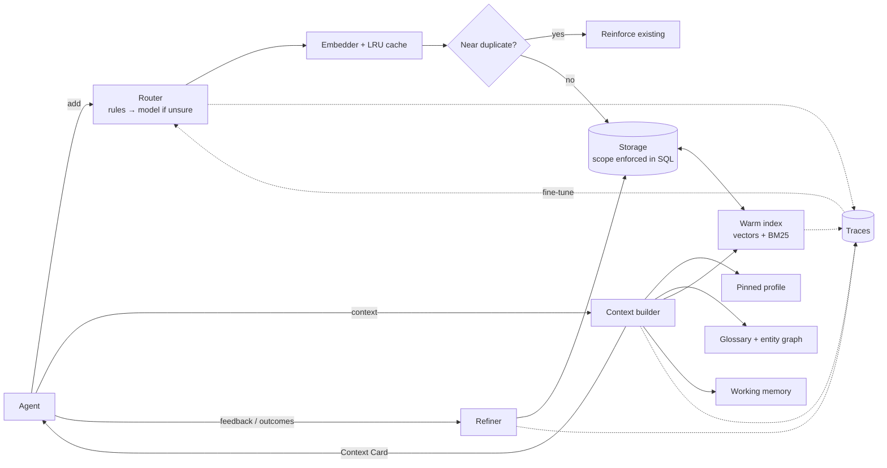

# smart-memory

**Long-term memory for AI agents that uses up to 99% fewer prompt tokens, runs offline, and keeps every user's data separate.**

[](https://github.com/surajmhaske02/smart-memory/actions/workflows/ci.yml)


Everyone uses the same frontier models. Agents that stand out remember the right things,
forget the noise, and get better with use. smart-memory gives any agent that memory layer,
whatever model or framework you use, in plain Python with no required dependencies.

```python
from smart_memory import Memory

memory = Memory("agent.db").scope(user_id="alice", agent_id="support")
memory.add("Alice prefers email, never phone calls")
prompt = f"You are a support agent.\n\n{memory.context('How should I contact Alice?')}"
```

## Why developers use it

Most agents do one of these, and each one costs you:

| Common approach | What goes wrong | What smart-memory does |
|---|---|---|
| Re-send the whole chat history | Cost grows with every turn; old facts fall out of the window | Sends a **Context Card**: only what this question needs, within a token budget |
| Plain vector RAG over notes | Pulls whatever looks similar, guesses at business terms, repeats near-duplicates | Combines vector, keyword, recency and importance ranking, plus an **entity graph** and a **glossary** of exact definitions |
| One memory store for everything | "Never share PINs" sits next to "user said hi", with no notion of failures or procedures | **Four stores** (working, episodic, semantic, procedural), with routing done for you |
| Access checks in the prompt | One prompt injection away from leaking another customer's data | **Isolation enforced in the database query** for every read and write |
| Static memory | Mistakes repeat; stale facts stay forever | **Learns**: feedback, procedure outcomes, dedupe, decay, and promotion of repeated patterns |

## Measured results

From [`benchmarks/`](benchmarks) (synthetic data, default offline embedder; see the [cost guide](docs/OPTIMIZATION.md)):

| | Everything in the prompt | smart-memory |
|---|---|---|
| Prompt tokens per turn (1,000 memories per user) | 14,225 | **~105 (‑99%)** |
| Correct memory in the prompt | 100% | 93% to 97% (with an offline lexical embedder) |
| Context latency at 20,000 memories | n/a | **17 ms** (44× faster than v0.1) |
| Embedding calls to ingest 20,000 memories | 20,000 | **1** |
| Writes that need an LLM router call (cascade) | 100% | **25%** |
| Cross-user leaks | n/a | **0** |

At 80,000 turns a day and $3 per million input tokens, that's about **$102k a month vs $760 a month**
for the memory part of the prompt. The [cost guide](docs/OPTIMIZATION.md) explains the math and the settings.

## Install

Not on PyPI yet. Install from GitHub:

```bash
pip install "git+https://github.com/surajmhaske02/smart-memory.git"
```

Optional: `pip install numpy` makes search about 4× faster. No other dependencies, and no API keys needed.

## Quick start

```python
from smart_memory import Memory

mem = Memory("agent.db")                                    # SQLite file, or Memory() for in-memory
alice = mem.scope(user_id="alice", agent_id="support", thread_id="chat-001")

# Retain: the router picks the right store for each memory
alice.add("Alice prefers email, never phone calls")                    # semantic / preference
alice.add("Always confirm the order number before a refund")           # procedural / instruction
alice.record_event("Refund API timed out for order 4411", outcome="failure")
alice.add("Alice is a premium customer", pin=True)                     # always in context
alice.glossary.define("refund window", "30 days from delivery", aliases=["return window"])
alice.graph.relate("Alice", "customer_of", "Acme Corp")

# Reuse: a compact memory block for your prompt
card = alice.context("Alice wants a refund on order 4411. What's the return window?", max_tokens=400)
print(card)
```

```markdown
## Memory
### Profile
- Alice is a premium customer
### Definitions
- refund window (aka return window): 30 days from delivery
### Procedures & instructions
- Always confirm the order number before a refund
### Facts
- Alice customer of Acme Corp
### Past events
- (just now) [failure] Refund API timed out for order 4411
```

More: [`examples/quickstart.py`](examples/quickstart.py) (a full tour) and
[`examples/agent_loop.py`](examples/agent_loop.py) (a complete agent loop for any LLM).

## Two ways to wire it into an agent

**1. You control memory.** Build a card each turn and save what the user says:

```python
def chat(memory, user_text):
    card = memory.context(user_text, max_tokens=600)
    reply = call_llm(system=f"{SYSTEM_PROMPT}\n\n{card}", user=user_text)
    memory.add(user_text)                              # the router decides where it goes
    memory.feedback(card.memory_ids, helpful=True)     # memories that get used rank higher
    return reply
```

**2. The model controls memory** through function calling (Anthropic, OpenAI, Gemini and others):

```python
from smart_memory import MemoryTools

tools = MemoryTools(memory)                    # remember + recall (forget is opt-in)
tool_defs = tools.schemas("anthropic")         # or "openai", or "json"
# ... when the model calls a tool:
result_json = tools.handle(call.name, call.arguments)
```

## Core ideas

### Four stores

| Store | Holds | Example | Lifetime |
|---|---|---|---|
| **Working** | Current goal, plan, recent turns | `goal: refund order 4411` | One thread, in process |
| **Episodic** | Events, outcomes, failures | `Refund API timed out (x3)` | Fades unless important or reused |
| **Semantic** | Facts, preferences, definitions, relations | `Alice prefers email` | Long-lived, versioned by `key` |
| **Procedural** | Workflows, rules, tool playbooks | `issue_refund: 1) ... 2) ...` | Long-lived, reinforced by outcomes |

### Four operations

| | Method | What it does |
|---|---|---|
| **Retain** | `add()`, `add_many()` | Route, embed, deduplicate, version and store |
| **Recall** | `search()` | Hybrid ranking inside the caller's scope |
| **Reuse** | `context()` | Build a Context Card within a token budget |
| **Refine** | `feedback()`, `record_outcome()`, `refine()` | Learn from usage, merge duplicates, archive stale items, promote patterns |

### Architecture



## Guide

<details open>
<summary><b>Scopes and access control</b></summary>

```python
alice_support = mem.scope(user_id="alice", agent_id="support")
alice_sales   = mem.scope(user_id="alice", agent_id="sales")
org           = mem.scope()                     # global: everyone can read, only this scope can write
```

- `user_id` and `agent_id` are hard boundaries, compiled into every storage query.
- `add(..., shared=True)` shares a memory with every agent acting for that user.
- `thread_id` records where a memory came from; it doesn't block access. Use `search(..., thread_only=True)` to stay inside one conversation.
- Changing a record you don't own raises `PermissionDenied`. `forget_user()` deletes everything a scope owns, for example to handle a GDPR erasure request.
</details>

<details>
<summary><b>Retain: storing memories</b></summary>

```python
alice.add("Alice is allergic to peanuts")                  # router picks type, kind and importance
alice.add("Met Alice at the Pune office", "episodic")      # set the type yourself
alice.add("Alice lives in Berlin", key="alice.city")       # versioned: a new value replaces the old one
alice.history("alice.city")                                # every version, newest first
alice.add("Alice is on the Enterprise plan", pin=True)     # always shown first in context
alice.add_many(lines_from_crm)                             # one embedding call, one transaction
alice.add_procedure("issue_refund", ["Verify order", "Check window", "Call refund API"],
                    when="customer asks for money back")
alice.record_event("Pricing API returned 503", outcome="failure")
```

A memory that nearly repeats an existing one doesn't create a new row. It reinforces the
existing one, so `metadata["occurrences"]` goes up and the card shows `(x3)`. Memories
with different numbers ("order 1234" vs "order 1235") or opposite meaning ("likes" vs
"doesn't like") are never merged.
</details>

<details>
<summary><b>Recall: searching</b></summary>

```python
for hit in alice.search("peanut allergy", k=5, memory_types=["semantic"]):
    print(hit.score, hit.content, hit.signals)   # semantic, keyword, recency, importance, reuse
```

A memory has to be actually relevant (`min_relevance`) before importance or recency can
lift it, so important but unrelated memories never reach the prompt.
</details>

<details>
<summary><b>Reuse: Context Cards and prompt caching</b></summary>

```python
card = alice.context(user_message, max_tokens=600, k=12, graph_depth=1, recent_turns=0)
card.render()            # markdown
card.render("xml")       # <memory>...</memory>
card.memory_ids          # what was included, for feedback
stable, dynamic = card.render_split()   # pinned profile first: put it in the provider's prompt cache
```

The budget is spent in priority order: profile, current state, definitions, procedures,
facts, past events, then recent conversation. Weak results are trimmed by
`ContextBuilder(relative_cutoff=0.5)`. Rules and procedures are never trimmed. Pass your
model's tokenizer with `ContextBuilder(token_counter=...)` for exact counts.
</details>

<details>
<summary><b>Entity graph and glossary</b></summary>

```python
alice.graph.relate("Acme", "supplier_of", "Globex")
alice.graph.relate("Alice", "reports_to", "Bob", exclusive=True)   # only one value at a time
alice.graph.neighbors("Acme", depth=2)
org.glossary.define("concentration", "Share of exposure held by the top 10 counterparties")
```

When a question mentions a known entity or term, its relations and exact definition go
straight into the card. The model doesn't have to guess what your business means by a word.
</details>

<details>
<summary><b>Refine: memory that improves</b></summary>

```python
alice.feedback(card.memory_ids, helpful=True)       # or a score from -1 to 1
alice.record_outcome("issue_refund", success=False)  # procedure success rate sets its importance
alice.refine(summarizer=my_llm_summarize)            # merge, archive, promote
# RefineReport(examined=120, merged=4, archived=17, promoted=1)
```

`refine()` merges near-duplicates, archives stale and unimportant episodes (they can be
recovered), and with a summarizer turns repeated episodes into a lesson, such as "the
pricing API times out under peak load; retry with backoff".
</details>

<details>
<summary><b>Traces: training data for continual learning</b></summary>

```python
mem.traces.export_jsonl("traces.jsonl")                  # routing, retrieval, feedback, refine events
mem.traces.routing_dataset("router_train.jsonl")         # {"text", "label", "source"}
alice.reclassify(record_id, "episodic")                  # human corrections become training labels
mem.cache_info()                                         # embedding calls saved, index rebuilds
```
</details>

## Use your own models and database

**Router.** Rules are free and deterministic. To use a small fine-tuned model or an LLM,
only for the writes the rules are unsure about:

```python
from smart_memory import CallableRouter
mem = Memory("agent.db", router=CallableRouter(my_classifier, escalate_below=0.6))
```

If the model fails, returns something invalid, or isn't confident, the rules decide, so a
write never fails because of the model.

**Embeddings.** The default embedder runs offline and matches wording. For matching meaning:

```python
from smart_memory import FunctionEmbedder, SentenceTransformerEmbedder

mem = Memory("agent.db", embedder=SentenceTransformerEmbedder())     # pip install sentence-transformers
mem = Memory("agent.db", embedder=FunctionEmbedder(my_embed_fn, dim=1536, name="my-model"))
```

The store records which embedder built it. Switching to a different one raises an error
unless you pass `on_embedder_change="reembed"`.

**Storage.** SQLite (default) and in-memory are built in. For Postgres/pgvector, Oracle,
MongoDB or Redis, subclass `StorageBackend` (about ten methods), apply `Scope` checks in
your queries, and run [`tests/test_storage_contract.py`](tests/test_storage_contract.py)
against it. Those tests check user isolation for you.

## Production checklist

- Use `add_many()` for bulk imports and run `refine()` from a scheduled job.
- `pip install numpy` for faster search.
- Pin always-needed facts and send `render_split()`'s stable part as a cached prefix.
- Keep 2 to 4 recent turns and let memory cover the rest of the history.
- Check `mem.cache_info()` and the routing traces from time to time.

The [cost and performance guide](docs/OPTIMIZATION.md) has presets, measurements and the cost math.

## Limits

- Ranking scans every memory in the scope. With numpy that's fine up to roughly 50k memories per user and agent; beyond that, use a vector-database backend.
- The warm index lives in each process. Writes from other processes are detected and trigger a rebuild, but each process keeps its own copy.
- The default embedder matches words, not meaning ("buy" won't find "bought"). Use a neural embedder when that matters.
- Working memory is per process; persist it with `end_session()`.

## Contributing

This project is new, so a contribution here makes a visible difference. Each area below is
self-contained, with a clear interface and existing tests to follow:

| Area | Idea | Where |
|---|---|---|
| Storage | Postgres + pgvector, MongoDB, Redis backend | `smart_memory/storage/`, contract tests included |
| Speed | Optional ANN index (hnswlib or FAISS) | `smart_memory/index.py` |
| Quality | Small ONNX embedder extra; learned ranking weights from traces | `embeddings.py`, `retrieval.py` |
| Developer experience | `AsyncMemory`, LangChain/LlamaIndex adapters, a CLI | new modules |
| Evaluation | Real-world memory benchmarks | `benchmarks/` |

```bash
git clone https://github.com/surajmhaske02/smart-memory.git && cd smart-memory
python -m venv .venv && source .venv/bin/activate
pip install -e ".[dev]" numpy
pytest            # 141 tests, under a second
ruff check smart_memory tests
```

See [CONTRIBUTING.md](CONTRIBUTING.md). Issues and discussions are welcome, including "I tried it and X was confusing".

## Credits

The design follows the agent-memory ideas in Richmond Alake's AI Engineer talk
*"Everyone Has the Same AI Models. Here's What Sets Agents Apart"*: four memory types, the
four operations, Context Cards, ontology and semantic layers, data-layer access control,
and memory traces for continual learning. This is an independent implementation, not
affiliated with the talk, its author, or any vendor.

## License

[MIT](LICENSE). Use it in commercial products, fork it, and build on it.
