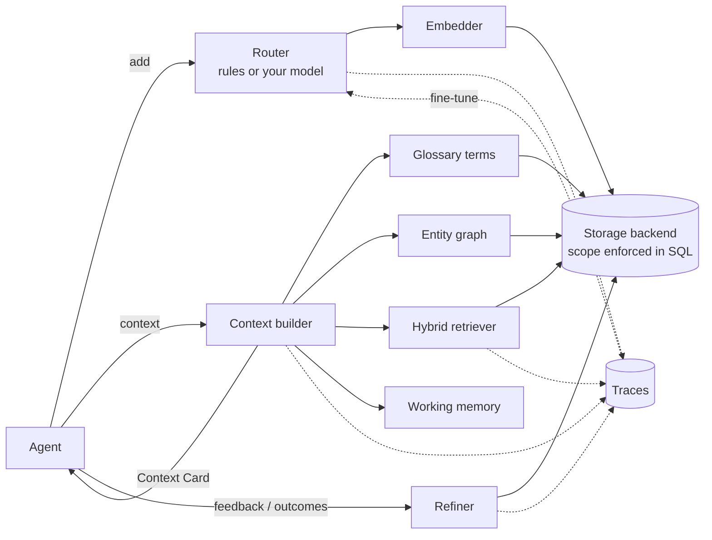

# smart-memory

**Governed, four-store memory for AI agents. Retain, Recall, Reuse, Refine.**

Every team has access to the same frontier models. What sets an agent apart is what it
remembers, how it structures that memory, and whether it gets better over time.
`smart-memory` is a small, dependency-free Python library that gives any agent
(any LLM, any framework) that memory layer:

- **Four cognitive stores**: working, episodic, semantic, procedural.
- **Automatic routing**: new text goes to the right store, using rules or your own model.
- **Hybrid recall**: vector similarity, BM25 keywords, recency, importance and reuse.
- **Context Cards**: a compact, token-budgeted memory block for the prompt instead of whole transcripts.
- **Ontology + semantic layer**: an entity graph and a glossary of canonical definitions.
- **Entitlements in the data layer**: user/agent isolation is enforced inside every database query.
- **Continual learning**: feedback, procedure outcomes, dedupe/decay/promotion, and exportable traces.

```bash
pip install smart-memory        # zero required dependencies, Python 3.9+
```

## Quick start

```python
from smart_memory import Memory

mem = Memory("agent.db")                     # SQLite file; Memory() for in-memory
alice = mem.scope(user_id="alice", agent_id="support", thread_id="chat-001")

alice.add("Alice prefers email, never phone calls")               # -> semantic / preference
alice.add("Always confirm the order number before a refund")      # -> procedural / instruction
alice.record_event("Refund API timed out for order 4411", outcome="failure")  # -> episodic / failure
alice.glossary.define("refund window", "30 days from delivery", aliases=["return window"])
alice.graph.relate("Alice", "customer_of", "Acme Corp")

card = alice.context("Alice wants a refund on order 4411. What's the return window?", max_tokens=400)
system_prompt = f"You are a support agent.\n\n{card}"
```

`card` renders as:

```markdown
## Memory
### Definitions
- refund window (aka return window): 30 days from delivery
### Procedures & instructions
- Always confirm the order number before a refund
### Facts
- Alice customer of Acme Corp
- Alice prefers email, never phone calls
### Past events
- (just now) [failure] Refund API timed out for order 4411
```

Run the full tour with `python examples/quickstart.py`, or see an agent loop in
[`examples/agent_loop.py`](examples/agent_loop.py).

## Core ideas

### The four stores

| Store | Holds | Example | Lifetime |
|---|---|---|---|
| **Working** | Current turn state: goal, plan, recent turns | `goal: refund order 4411` | One thread, in process |
| **Episodic** | Time-stamped events, outcomes, failures | `Refund API timed out yesterday` | Decays unless important or reused |
| **Semantic** | Facts, preferences, definitions, entity relations | `Alice prefers email` | Long-lived, versioned by `key` |
| **Procedural** | Workflows, rules, personas, tool playbooks | `issue_refund: 1) ... 2) ...` | Long-lived, reinforced by outcomes |

### The four Rs

| Operation | Method | What it does |
|---|---|---|
| **Retain** | `add()` / `retain()` | Route, embed, version and store |
| **Recall** | `search()` / `recall()` | Hybrid ranking within the caller's scope |
| **Reuse** | `context()` / `reuse()` | Compile a Context Card within a token budget |
| **Refine** | `feedback()`, `record_outcome()`, `refine()` | Adjust importance, merge duplicates, archive stale items, promote patterns |

### Architecture



## Guide

### Scopes and entitlements

```python
alice_support = mem.scope(user_id="alice", agent_id="support")
alice_sales   = mem.scope(user_id="alice", agent_id="sales")
org           = mem.scope()                      # global: readable by all, writable only here
```

- `user_id` is a hard boundary. Other users never see your records.
- `agent_id` is a hard boundary. Use `add(..., shared=True)` to share a record with every agent acting for that user.
- Global records (`mem.scope()`) are visible to everyone but can only be modified by the global scope.
- `thread_id` is provenance, not a boundary: agents remember earlier conversations. Use `search(..., thread_only=True)` to stay inside one.

These rules are compiled into the storage query, so a prompt injection cannot talk the
agent into reading another user's memory. Modifying a record you don't own raises
`PermissionDenied`.

### Retain

```python
alice.add("Alice is allergic to peanuts")                    # router picks type + kind + importance
alice.add("Met Alice at the Pune office", "episodic")        # explicit type
alice.add("Alice lives in Berlin", key="alice.city")         # versioned fact: a new value supersedes
alice.history("alice.city")                                  # every version, newest first
alice.add_procedure("issue_refund", ["Verify order", "Check window", "Call refund API"],
                    when="customer asks for money back")
alice.record_event("Pricing API returned 503", outcome="failure")
```

### Recall

```python
for hit in alice.search("peanut allergy", k=5, memory_types=["semantic"]):
    print(hit.score, hit.content, hit.signals)   # signals: semantic, keyword, recency, importance, reuse
```

Candidates must pass a relevance gate (`RetrievalConfig.min_relevance`), so an important
but unrelated memory never leaks into a prompt. Near-identical results are collapsed.

### Reuse: Context Cards

```python
card = alice.context(user_message, max_tokens=600, k=12, graph_depth=1, recent_turns=0)
card.render()        # markdown (default)
card.render("xml")   # <memory><facts>...</facts></memory>, handy for models that like XML tags
card.memory_ids      # what was included, for feedback
card.truncated       # True if the budget cut something
```

The budget is spent in priority order: current state, then definitions, procedures,
facts, past events, and recent conversation. Pass your model's tokenizer with
`ContextBuilder(token_counter=...)` for exact counts.

### Ontology and semantic layer

```python
alice.graph.relate("Acme", "supplier_of", "Globex")
alice.graph.relate("Alice", "reports_to", "Bob", exclusive=True)  # single-valued
alice.graph.neighbors("Acme", depth=2)
alice.graph.find_entities("How exposed are we to Globex?")      # ['Globex']

org.glossary.define("concentration", "Share of exposure held by the top 10 counterparties")
```

When a query mentions a known entity or term, its relations and canonical definition go
into the Context Card verbatim. The agent doesn't have to guess what "concentration" means
from whichever chunk was most similar.

### Working memory and sessions

```python
alice.working.set("goal", "refund order 4411")
alice.add_turn("user", "I want my money back")
alice.end_session(summarizer=my_llm_summarize)   # working -> one episodic summary
```

### Refine: memory that improves

```python
alice.feedback(card.memory_ids, helpful=True)     # or helpful=-0.5 .. 1.0
alice.record_outcome("issue_refund", success=False)
report = alice.refine(summarizer=my_llm_summarize)
# RefineReport(examined=120, merged=4, archived=17, promoted=1)
```

`refine()` merges near-duplicates (newest wording wins, signals add up), archives stale,
unimportant, unused episodes (soft and recoverable), and with a summarizer turns recurring
episodes into a semantic insight such as "the pricing API times out under peak load;
retry with backoff". Tune it with `Memory(refiner=Refiner(...))`.

### Traces for continual learning

Every routing, retrieval, context, feedback, outcome and refine decision is logged.

```python
mem.traces.export_jsonl("traces.jsonl")
rows = mem.traces.routing_dataset("router_train.jsonl")  # {"text", "label", "source"}
alice.reclassify(record_id, "episodic")                  # human fixes become training labels
```

Use the dataset to fine-tune a small classifier (Qwen, ModernBERT, a logistic regression),
then plug it back in:

```python
from smart_memory import CallableRouter
mem = Memory("agent.db", router=CallableRouter(my_classifier, min_confidence=0.6))
```

If the model raises, returns garbage, or is unsure, the rule router takes over, so a flaky
model never blocks a write.

## Plug in your stack

**Embeddings.** The default `HashingEmbedder` is offline, deterministic and needs no
dependencies. It matches wording, not meaning. For paraphrase-level recall, use a neural model:

```python
from smart_memory import FunctionEmbedder, SentenceTransformerEmbedder

mem = Memory("agent.db", embedder=SentenceTransformerEmbedder("all-MiniLM-L6-v2"))  # pip install smart-memory[local]

def embed(texts):                       # any provider
    return [d.embedding for d in client.embeddings.create(model="...", input=texts).data]
mem = Memory("agent.db", embedder=FunctionEmbedder(embed, dim=1536, name="my-embedder"))
```

The store remembers which embedder built it. Opening it with a different one raises
`EmbedderMismatchError`; pass `on_embedder_change="reembed"` to migrate.

**Storage.** `SQLiteStore` (default) and `InMemoryStore` ship in the box. To use Postgres
with pgvector, Oracle, MongoDB or Redis, subclass `StorageBackend` (about ten methods),
compile `Scope` visibility into your queries, and add your backend to
`tests/test_storage_contract.py`; the contract suite checks isolation for you.

**LLM.** smart-memory never calls a model itself. Summarizers and routers are plain
callables, so it works with any provider or framework.

## Benchmarks

`python benchmarks/benchmark.py` builds synthetic users with hundreds to thousands of
memories each, then asks questions whose answer is one specific memory. It compares the
naive "put everything in the prompt" approach with a 300-token Context Card. Results on an
M-series Mac with the default hashing embedder:

| Memories per user | Naive prompt tokens | Context Card tokens | Reduction | Answer in prompt | Cross-user leaks | p50 latency |
|---|---|---|---|---|---|---|
| 300 | 4,271 | 141 | 96.7% | 93.3% | 0 | 9 ms |
| 1,000 | 14,225 | 146 | 99.0% | 93.3% | 0 | 34 ms |

The one miss is "Which product did X buy?" against a memory that says "bought". An
irregular verb has no shared vocabulary for a lexical embedder to match; a neural
embedder handles it. The dataset is synthetic, so treat these numbers as a smoke test
and benchmark on your own data.

## Scale and limits

- Vector scoring runs in Python over the scope's candidates. That's fine up to roughly
  tens of thousands of memories per user and agent. Beyond that, use a vector-database backend.
- `refine()` dedupe is O(n²) per scope. Run it in a background job, not on every turn.
- The rule router is heuristic. Check the routing traces and move to `CallableRouter` when accuracy matters.
- Working memory is per process. In multi-process deployments, persist what matters with `end_session()`.

## Development

```bash
python -m venv .venv && source .venv/bin/activate
pip install -e ".[dev]"
pytest --cov=smart_memory      # 118 tests
ruff check smart_memory tests
```

See [CONTRIBUTING.md](CONTRIBUTING.md). Good first contributions: new storage backends,
embedder adapters, router training scripts, and async wrappers.

## Credits

The architecture follows the agent-memory ideas in Richmond Alake's AI Engineer talk
*"Everyone Has the Same AI Models. Here's What Sets Agents Apart"*: the four memory
types, the four Rs, Context Cards, ontology and semantic layers, data-layer entitlements,
and memory traces for continual learning. This is an independent implementation, not
affiliated with the talk, its author, or any vendor.

## License

[MIT](LICENSE)
